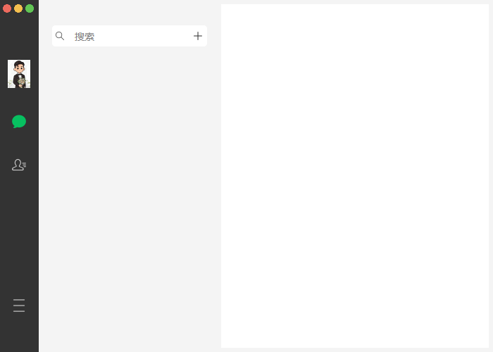
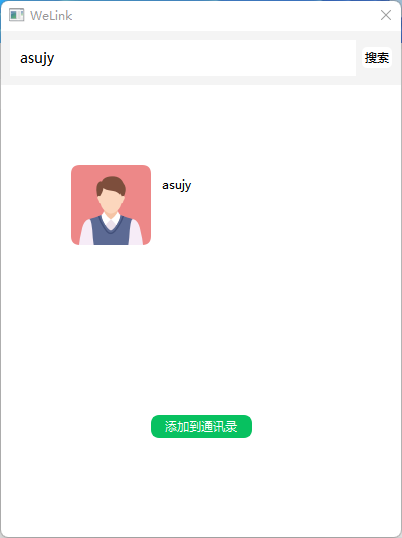
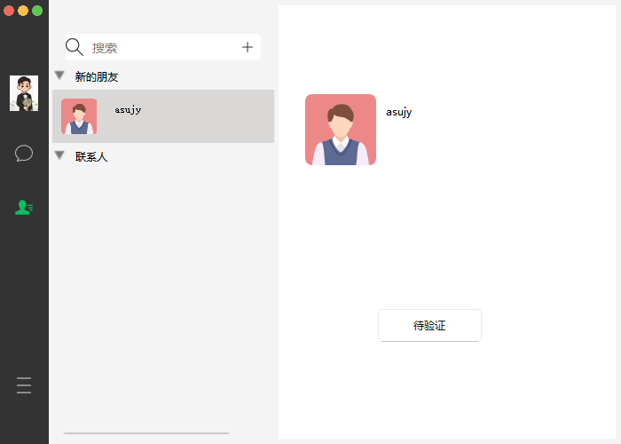
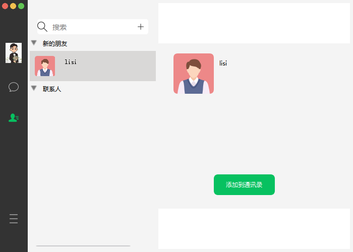
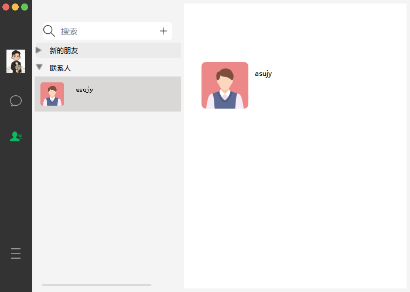
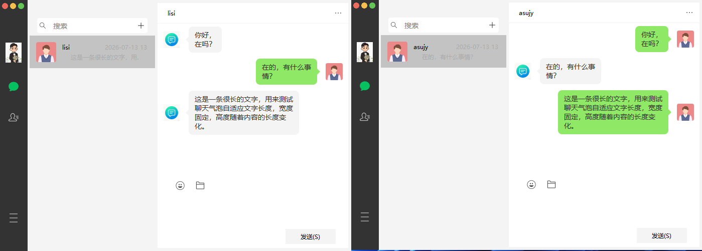

# WeLink
基于 C++ / Qt 开发的桌面即时通讯客户端  

 

# 快速开始
- 下载项目中的 `WeLink-Window64.zip`，解压之后直接点击执行WeLink.exe，进行登录注册。 
- `WeLink-MacOSArm64.zip`是MacOS版本

 

# 模块说明
|   模块名称    |                                              模块用途                                              |
| :-----------: | :------------------------------------------------------------------------------------------------: |
|      app      |       程序入口 + 业务调度中枢，串联网络、数据库、界面三大模块，处理登录、聊天整体业务逻辑。        |
|    DBMagr     | 统一封装所有 SQLite 数据库操作，隔离业务代码与原生 QtSql API，提供对数据的增删改查，全局单例调用。 |
|    common     |                                  全局常量、通用工具函数、基础封装                                  |
|     model     |                              定义项目所有数据实体结构体，统一数据格式                              |
|      net      |           封装 Qt TcpSocket，实现客户端与 IM 服务端双向通信，负责消息收发、字节流处理。            |
| ui_components |                         全部界面组件，自定义 UI 控件：气泡、输入框、窗口等                         |

# 已实现功能
> 需要服务端配合的功能，实际使用还取决于服务端是否在线并遵循相同通信协议。

[登录模块](doc/login.md)  
[注册模块](doc/register.md)  
[主窗口与左侧导航模块](doc/mainwindow.md)  
[聊天模块](doc/chat.md)  
[联系人与好友申请模块](doc/contacts.md)  
[网络通信模块](doc/network.md)  
[数据库模块](doc/db.md)  

# 开发计划
目前聚焦于WeLinkServer项目（服务端），当前项目后面会继续开发，目前已知的bug也之后再修改！
- [x] 联系人列表中的数据保存到本地数据库中
  - [x] 新的朋友列表中的数据保存到本地数据库中
  - [x] 联系人列表中的数据保存到本地数据库中
  - [x] 登录的时候从数据库中读取联系人列表数据到界面中
- [x] 修复添加好友窗口重复打开会导致软件崩溃的bug 

# 功能展示

